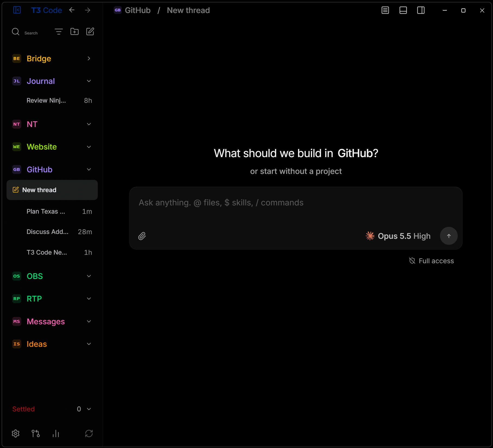

# T3 Code: Edge's custom Windows build

My personal build of [T3 Code](https://github.com/pingdotgg/t3code), the open-source
app for running coding agents like Codex and Claude. It adds my own changes for
privacy, cleanup, readability and the way I work.

Colored project names in the screenshot use **Settings > Labs > Boring sidebar >
Name matches icon color**. That switch is Off by default.

This is not an official release. For the regular app, use
[Theo's project](https://github.com/pingdotgg/t3code). This fork's `main` branch
is a copy of Theo's code as of my last update, so it may be behind his. My build is
the `edge358-custom-build` branch, shown here.

Thank you to Theo and the T3 Code team for building it in the open, which let me
shape it to my own workflow.

## What's different

- **Privacy:** reporting, cloud and remote features, and automatic updates are off.
  Outside images need your consent.
- **Full delete:** deleting a conversation also deletes it from Codex and Claude Code,
  so it disappears from their apps too.
- **After deleting** the thread you're viewing, you land on a neutral welcome page.
- **Sidebar:** drag projects to reorder them, optional project-name colors, and a folder chooser for new threads.
- **Readability:** larger text sizes, adjustable menu sizes, quieter headings.
  **Settings > Appearance > Typography > Advanced > Separate fonts** reveals
  separate controls for sidebar, conversation and menu text.
- **Optional spoken replies** through a speech service you already run.

Details and reasons: [Custom changes](CUSTOM_CHANGES.md) ·
[Privacy review](docs/custom-build/privacy-review.md)

## Status

- Source based on T3 Code v0.1.10 with selected upstream security and reliability
  fixes reviewed on November 17, 2026. It catches up with Theo's releases from time to time.
- Windows only, tested on one machine.
- Download the Windows installer from
  [Releases](https://github.com/Edge358/t3code/releases).
  [Start Here](START_HERE.md) walks you through setup.
- Problems with this build: open an [issue](https://github.com/Edge358/t3code/issues) here.
  Problems with T3 Code itself go to [Theo's project](https://github.com/pingdotgg/t3code/issues).

## Suggestions for T3 Code

Changes that might help everyone will be offered to Theo one at a time, each on
its own branch in this fork.

## Credit and license

T3 Code is made by T3 Tools Inc. Their [LICENSE](LICENSE) applies to this build.
This build is not endorsed by them.
